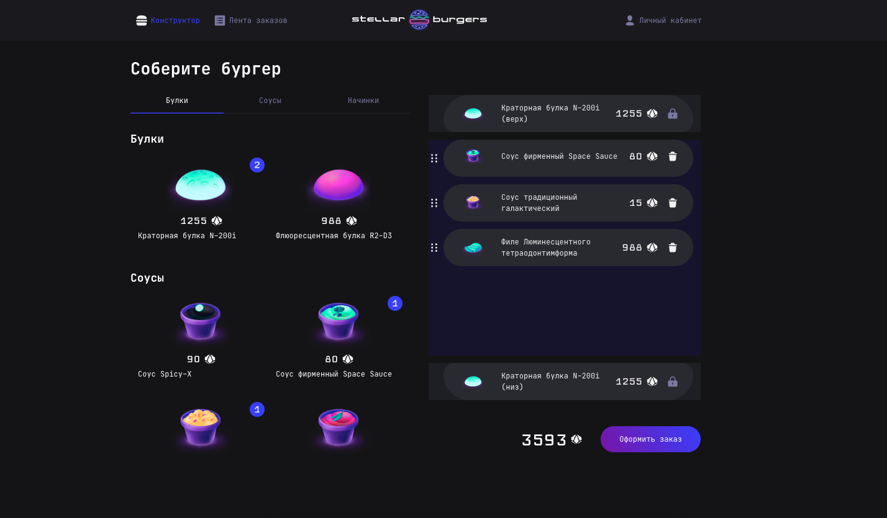

# 👽 Проект Stellar Burger 👽

Сайт космической бургерной, на которой можно собрать бургер из ингредиентов и сделать заказ.

### Ссылки

[GitHub Pages](https://ann-wi.github.io/react-burger/)
| [Макет в Figma](https://www.figma.com/file/ocw9a6hNGeAejl4F3G9fp8/React-_-%D0%9F%D1%80%D0%BE%D0%B5%D0%BA%D1%82%D0%BD%D1%8B%D0%B5-%D0%B7%D0%B0%D0%B4%D0%B0%D1%87%D0%B8-(3-%D0%BC%D0%B5%D1%81%D1%8F%D1%86%D0%B0)_external_link?node-id=6291:2799)




### Функциональность
- главная страница (перетаскивание ингредиентов в конструктор, внутри конструктора, оформление заказа);
- регистрация, авторизация, восстановление пароля, выход из профиля;
- изменение данных профиля;
- просмотр ленты всех и своих заказов;
- модальные окна (один ингредиент, номер заказа, детали заказа).

### Используемые инструменты и технологии
- Для написания проекта использовалась библиотека React;
- HTML и CSS;
- Redux для создания единого хранилища и управления состоянием приложения;
- react-router-dom использован для роутинга;
- react-dnd применяется для перетаскивания ингредиентов и формирования полноценного бургера для заказа;
- TypeScript - для типизации кода приложения;
- Jest, Cypress - тестирование приложения;
- Websocket - обеспечивает непрерывный поток данных заказов с бэкенда, который позволяет получать заказы и просматривать их статусы в режиме реального времени;
- accessToken и refreshToken. При регистрации и входе выдаются оба токена. accessToken служит для автоматического входа в приложение при перезагрузке страницы. refreshToken служит для обновления предыдущего в случае если он истек.

### Запуск проекта

Для запуска проекта локально выполните следующие шаги:

1. Клонируйте репозиторий:
	  ```bash
		git clone https://github.com/ann-wi/react-burger.git

2. Перейдите в директорию проекта:
	  ```bash
		cd react-burger

3. Установите зависимости:
	  ```bash
		npm install

4. Запустите проект:
	  ```bash
		npm start

5. Откройте проект в браузере:
	Перейдите по адресу [http://localhost:3000](http://localhost:3000) в вашем браузере.


6. Соберите проект:
	 Для создания production-сборки используйте команду:
	  ```bash
		yarn build

## Системные требования
Для работы с проектом потребуется Node.js и любой современный браузер.